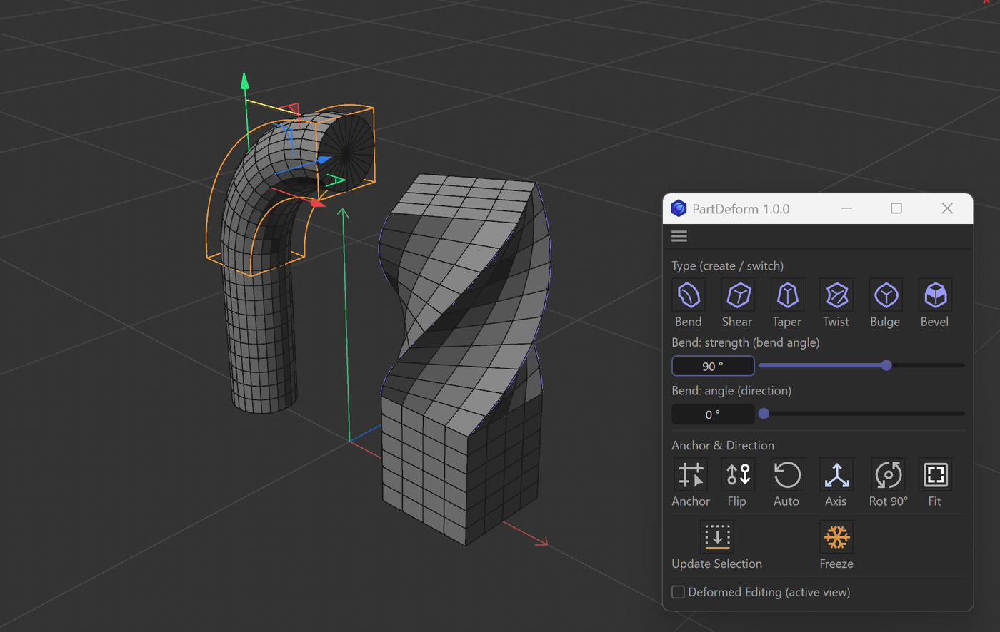
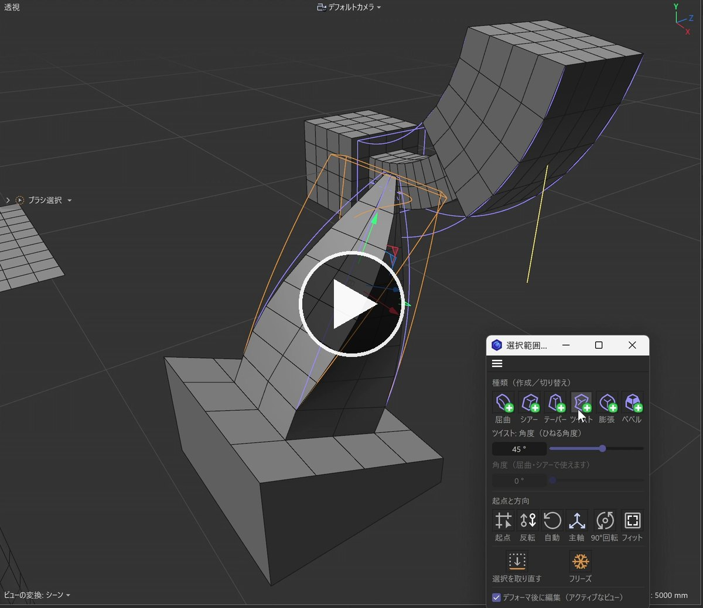
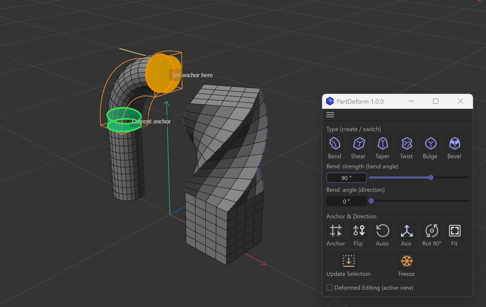

# PartDeform for Cinema 4D

[日本語](README_ja.md)

**Deformers that fit your selection — automatically.**



**[⬇ Download PartDeform 1.0.0 (zip)](https://github.com/mojon1/PartDeform/releases/download/v1.0.0/PartDeform-v1.0.0-plugin.zip)** — free. Unzip it and put the `PartDeform` folder into your Cinema 4D `plugins` folder ([Installation](#installation)).

<a href="https://youtu.be/VMyHsNeK2TE"></a>

▶ [Watch PartDeform in use on YouTube (50 s)](https://youtu.be/VMyHsNeK2TE)

Select polygons, points or edges and click Bend, Shear, Taper, Twist, Bulge or Bevel.
The deformer box is **sized, positioned and oriented to exactly that selection** (following the edge flow),
and only the selected part is deformed. The side connected to the rest of the mesh becomes the anchor automatically.
No more *Fit to Parent* that fits the whole object, rotating the box by hand, or dragging selection tags into Fields.

PartDeform brings the "deform just this part" workflow — like Modo falloffs or 3ds Max sub-object modifiers —
to **Cinema 4D polygon modeling**. Adjust in real units (mm and degrees), switch or stack deformers,
and **Freeze** the result into the mesh when you are done.

- Free and open source ([MIT License](LICENSE)): anyone can copy, share and modify it.
- It only creates standard deformers and selection tags, so scenes open with the same shape on machines or render farms without the plugin.
- English and Japanese UI (Japanese when Cinema 4D runs in Japanese, English otherwise).

> Latest release: [1.0.0](https://github.com/mojon1/PartDeform/releases/latest) ([changelog](CHANGELOG.md))

## Requirements

- Cinema 4D 2027 (tested on Windows and macOS). Earlier versions are untested; R20 or later is required at minimum (Fields) and R23 or later for Python 3.

## Installation

1. Download `PartDeform-v1.0.0-plugin.zip` from [Releases](https://github.com/mojon1/PartDeform/releases/latest) and unzip it
   (not "Source code", which GitHub adds automatically).
2. Put the `PartDeform` folder (the one that contains `PartDeform.pyp`, `partdeform` and `res`) into your Cinema 4D `plugins` folder.
   The `plugins` folder is inside the preferences folder, which you can open with the button at the bottom left of the Preferences window
   (**Edit > Preferences**; on macOS it may be under the **Cinema 4D** menu). Create the `plugins` folder if it does not exist.
   You can also keep the folder anywhere and add its location to the plugin search paths in **Preferences > Plugins**.
3. Restart Cinema 4D.
4. Open the panel from **Extensions > PartDeform**. Docking it into your layout is handy.

To update, replace the `PartDeform` folder with the new one (keep the folder name; do not keep two versions side by side).
The version is shown in the panel title and in `VERSION.txt`.

The menu contains "PartDeform" (the panel) and six commands, "Bend to Selection" to "Bevel to Selection".
You can assign the commands to shortcuts or palettes in the Command Manager.

## Usage

1. On an editable polygon object, select polygons, points or edges.
2. Press a type button in the panel (Bend, Shear, Taper, Twist, Bulge, Bevel).
   - A deformer fitted to the selection is added, and only the selected part is deformed.
   - It starts with a small amount so the direction is easy to see (Bend / Twist 45°, Taper / Bulge 30%, Shear offsets the tip by about 20% of the length).
3. Adjust the amount in the panel's value fields (angles for Bend and Twist, lengths for Shear, Taper, Bulge and Bevel), or in the Attribute Manager or with the viewport handles.
   If the direction is wrong, press **Anchor** and click the side that should stay fixed, or use the other Anchor & Direction buttons.
4. Press **Freeze** to bake the result. If you keep the deformer, it keeps working like any other deformer.

- With a PartDeform deformer selected, a type button **switches the type** and keeps the box and the direction.
- **Shift+click** a type button to **stack** a new deformer on the same selection and direction (for example Taper + Twist).
  While you hold Shift over the panel, a green + appears on the icons.


*Anchor mode: the green band is the current anchor, the orange band is the side you would set by clicking.*

- To change the affected area later, reselect on the mesh, click the deformer in the Object Manager, and press **Update Selection**.

## Panel

| Item | What it does |
|---|---|
| Bend ... Bevel | Creates a deformer on a selected mesh; switches the type on a selected PartDeform deformer; Shift+click stacks another one |
| Value field (1st row) | **Bend: strength (bend angle), Twist: angle** as angles. **Shear: tip offset, Taper: tip inset per side, Bulge: middle bulge per side, Bevel: offset** as real lengths (the strength % is calculated for you). Uses your Cinema 4D unit settings |
| Value field (2nd row) | **Bend / Shear angle (direction)**. For Shear, the strength is recalculated so the tip offset (length) stays the same |
| Anchor | Anchor mode: click a side of the object in the viewport to make it the anchor. Keep clicking to switch. Green band = current anchor, orange band = the side you would set. Click outside the object, press Anchor again, press another button, or Esc to finish |
| Flip | Swap the anchor and the tip |
| Auto | Reset the direction and the anchor to automatic |
| Axis | Switch the main (bend / twist) axis to another axis of the box |
| Rot 90° | Rotate 90° around the main axis (changes the bend / shear direction) |
| Fit | Refit the box to the selection tag, keeping the direction (after editing the mesh or the tag) |
| Update Selection | Replace the selection tag with the mesh's current selection and detect the direction and anchor again (like changing the sub-object selection below a modifier in 3ds Max) |
| Freeze | Bake the deformation into the polygons and remove the deformer and the selection tag created by PartDeform. Tags, materials, UVs and hierarchy stay. One undo step |
| Deformed Editing | Toggles the viewport option "Deformed Editing" for the active view (the same setting as in the view menu) |

Like the Attribute Manager, the sliders update the viewport while dragging, and a whole drag is one undo step.
Messages are shown in the Cinema 4D status bar and the console.

## Automatic direction and anchor

- **Anchor on the unselected side**: the border between the selection and the rest is the anchor, and the main axis points from the border to the farthest part (for a protrusion: base to tip).
- **Bend direction**: toward the surface normal for a surface selection; the thinner direction of the cross-section for protrusions.
- **Follows the edge flow**: the in-plane direction and the rotation around the main axis follow the edges of the selected polygons, so the box lines up with the edges even on slanted faces or square-like selections.
- When the border surrounds the selection (for example, only the middle of a face is selected), the direction is taken from the shape.

## Bevel

Bevel works differently from the other five (it cuts corners and adds faces, so the topology changes).

- It has no box and no Fields. It is limited by putting the selection tag's name into the Bevel deformer's "Selection" field (the standard Cinema 4D way).
- "Use Angle" is turned off. The offset starts at 3% of the selection size.
- The Anchor & Direction buttons do not apply. The value field shows the Bevel offset as a length (not in Proportional offset mode).
- Freeze applies the Bevel tool with the same settings directly to the mesh (UVs, selection tags and n-gons are updated correctly).

## How it works

- The effect is limited with a Variable Tag layer in the deformer's **Fields**, pointing to the selection tag (`PD_Sel`, `PD_Sel.1`, ...).
  This is the same as dragging the selection tag into the Fields yourself, so you can add falloff fields on top.
- The bottom of the box (local -Y) has no effect and the top has the full effect (Bulge: both ends have no effect). The bottom is placed at the anchor of the selection.

## Notes

- **Child objects of the mesh are deformed too.** A Variable Tag field layer returns full weight for objects without the tag (standard Cinema 4D behavior). A warning is shown in the status bar when the deformer is created. Freeze bakes only the mesh.
- If both ends of the selection connect to unselected parts, the border at the tip side shows a step or distortion (standard deformer behavior).
- Shear strength is a percentage of the box width (Cinema 4D's definition), so shearing a flat face along its normal needs several hundred %. The panel shows the real offset as a length.
- Switching the type does not carry over keyframes on the deformer itself.
- Meshes with a Normal tag (explicit normals) keep the old normals after Freeze.

## Development

- `tests/run_partdeform_tests.py`: integration tests. Open and run it in the Script Manager. It works in a new document and does not touch your scenes (save your work before running it). Results are printed to the console.
- `tools/build_release.py`: builds the release zip from the committed files (`dist/PartDeform-v<version>-plugin.zip`). The version comes from `__version__` in `partdeform/__init__.py`.
- Set the environment variable `PARTDEFORM_LANG` to `ja` or `en` to force the UI language.

```
PartDeform/
  PartDeform.pyp          registration
  partdeform/core.py      selection analysis, create / orient / fit / freeze
  partdeform/ui.py        panel, anchor tool, commands
  partdeform/i18n.py      Japanese / English strings
  partdeform/icons.py     type button icons (with the green + while Shift is held)
  partdeform/winowner.py  keeps the floating panel above the main window on Windows
  res/                    minimal resources needed to register the tool
  tests/                  integration tests and a test scene
  tools/build_release.py  builds the release zip
```

## License

[MIT License](LICENSE) © 2026 Taichi Teramura
