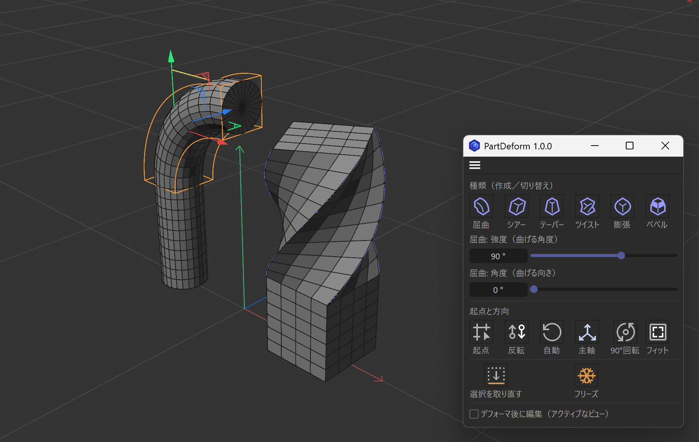
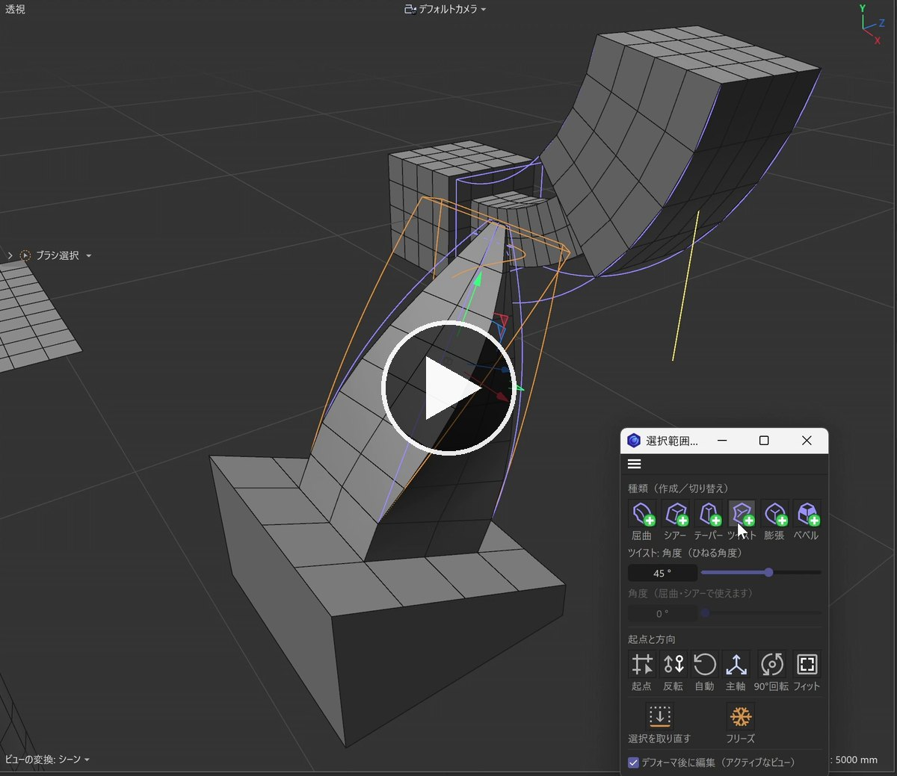
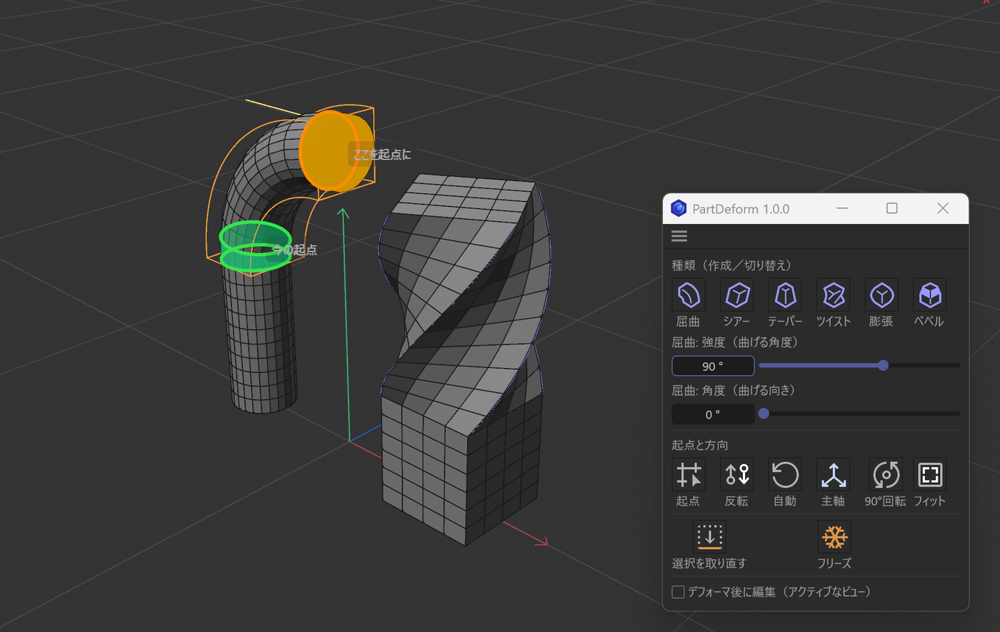

# PartDeform（Cinema 4D 用プラグイン）

[English](README.md)

**選んだ部分に、デフォーマーが自動でフィット。**



**[⬇ PartDeform 1.0.0 をダウンロード（zip）](https://github.com/mojon1/PartDeform/releases/download/v1.0.0/PartDeform-v1.0.0-plugin.zip)** — 無料。[Gumroad](https://mojon.gumroad.com/l/partdeform) でも配布しています（お好きな金額で応援できます）。展開して、`PartDeform` フォルダを C4D の `plugins` フォルダに入れてください（[インストール](#インストール)）。

<a href="https://youtu.be/VMyHsNeK2TE"></a>

▶ [使っている様子の動画を YouTube で見る（50秒）](https://youtu.be/VMyHsNeK2TE)

ポリゴン・ポイント・エッジを選んで、屈曲・シアー・テーパー・ツイスト・膨張・ベベルのボタンを押すだけ。
デフォーマーの箱が**選択範囲にぴったりの大きさ・位置・向き**（エッジの流れに沿う）で置かれ、選んだ部分だけが変形します。
本体とつながっている側が自動で起点（効果が 0 になる側）になります。
オブジェクト全体に合わせてしまう「親に合わせる」、箱を手で回す作業、選択範囲タグをフィールドに入れる手間は要りません。

Modo のフォールオフや 3ds Max のサブオブジェクト＋モディファイヤのような「この部分だけ変形する」作り方を、
**Cinema 4D のポリゴンモデリング**に持ち込みます。実寸（mm・角度）で調整し、デフォーマーを切り替えたり重ねたりして、
決まったら**フリーズ**でメッシュに焼き込めます。

**あくまで補助ツール。シーンはプラグインに依存しません。** PartDeform が作るのは、標準のデフォーマー・選択範囲タグ・フィールドという、
手で組むのと同じ C4D 標準の構成だけです。実際にメッシュを変形しているのは C4D 標準の機能なので、
プラグインが入っていない PC やレンダーファームでも、同じ形で開いてレンダリングできます。

- 無料・オープンソース（[MIT ライセンス](LICENSE)）。誰でもコピー・配布・改変できます。
- 表示は日本語と英語に対応しています（C4D の表示言語が日本語なら日本語、それ以外は英語）。

> 最新版: [1.0.0](https://github.com/mojon1/PartDeform/releases/latest)（[変更履歴](CHANGELOG.md)）

## 動作環境

- Cinema 4D 2027（Windows・macOS で確認済み）。それより前のバージョンは未確認です（少なくともフィールドのある R20 以降、Python 3 の R23 以降が必要）。

## インストール

1. [Releases](https://github.com/mojon1/PartDeform/releases/latest) から `PartDeform-v1.0.0-plugin.zip` をダウンロードして展開します
   （GitHub が自動で付ける「Source code」ではありません）。
2. `PartDeform` フォルダ（`PartDeform.pyp`・`partdeform`・`res` が入っているフォルダ）を丸ごと、C4D のプラグインフォルダに置きます。
   プラグインフォルダは、設定ウィンドウ（**編集 ＞ 設定**。macOS では **Cinema 4D** メニューにある場合があります）の左下のボタンで開ける設定フォルダの中の `plugins` です。
   `plugins` フォルダが無ければ作ってください。
   好きな場所に置いて、**設定 ＞ プラグイン** の検索パスにそのフォルダを足しても使えます。
3. C4D を再起動します。
4. **機能拡張 ＞ PartDeform** からパネルを開きます。レイアウトにドッキングしておくと便利です。

更新するときは、`PartDeform` フォルダを新しいものに置き換えてください（フォルダ名はそのまま。古い版と並べて置かないでください）。
バージョンは、パネルのタイトルと `VERSION.txt` で確かめられます。

メニューには「PartDeform」（パネル）と「選択範囲に屈曲」〜「選択範囲にベベル」の6個が入ります。
種類ごとのコマンドは、コマンドマネージャーでショートカットやパレットにも割り当てられます。

## 使い方

1. 編集可能なポリゴンオブジェクトで、ポリゴン・ポイント・エッジのどれかを選択します。
2. パネルの種類ボタン（屈曲・シアー・テーパー・ツイスト・膨張・ベベル）を押します。
   - 選択範囲に合わせてデフォーマーが置かれ、選択した部分だけが変形します。
   - 向きがすぐ分かるように、少しだけ効かせた状態で作ります（屈曲・ツイスト 45°、テーパー・膨張 30%、シアーは先端が長さの約 20% ずれる強度）。
3. 強さはパネルの数値欄で調整します（屈曲・ツイストは角度、シアー・テーパー・膨張・ベベルは長さ）。属性マネージャーやビューのハンドルでも調整できます。
   向きが違うときは「起点」ボタンで起点にしたい端をクリックするか、「起点と方向」のほかのボタンで直します。
4. 確定するときは「フリーズ」を押します。そのまま残せば、普通のデフォーマーとして使い続けられます。

- デフォーマーを選んだまま種類ボタンを押すと、**箱と向きはそのままで種類だけ切り替わります**。
- **Shift＋クリック**なら、同じ選択範囲・同じ向きで新しいデフォーマーを**重ねて追加**します（例: テーパー＋ツイスト）。
  パネルの上で Shift を押している間は、各アイコンの右下に緑の＋が出ます。
- パイプの途中を曲げて先の部分も付いてこさせたいときなどは、パネルの **「選択範囲に限定」をオフ** にします。
  選択していない部分も標準のデフォーマーと同じように変形し、箱の先の部分は形を保ったまま付いてきます。


*起点モード: 緑の帯が今の起点、オレンジの帯はクリックすると起点になる端です。*

- あとから効かせる範囲を変えたいときは、メッシュで選択し直し、オブジェクトマネージャーでデフォーマーをクリックして「選択を取り直す」を押します。

## パネル

| 項目 | 動き |
|---|---|
| 屈曲〜ベベル | メッシュ選択中は新規作成。PartDeform のデフォーマー選択中は種類の切り替え。Shift＋クリックで重ねて追加 |
| 選択範囲に限定 | **オン（既定）**: 選択した部分だけが変形します。**オフ**: フィールドの変数タグレイヤーを「有効」オフにして、標準のデフォーマーと同じ動きにします（箱の中は選択していない部分も変形し、屈曲なら箱の先の部分も曲がった先へ付いてきます）。PartDeform のデフォーマーを選んでいればその状態を表示・切り替え（アンドゥ1回）、これから作るデフォーマーの既定値にもなります（C4D を終了しても残ります）。ベベルは対象外 |
| 数値欄（1段目） | **屈曲＝強度（曲げる角度）、ツイスト＝角度** は角度で、**シアー＝先端のずれ、テーパー＝先端の片側の絞り、膨張＝中央の片側のふくらみ、ベベル＝オフセット** は実際に動く長さで表示・入力します（強度 % を逆算して入れます）。単位は C4D の単位設定に従います |
| 数値欄（2段目） | **屈曲・シアーの角度（曲げる向き・ずらす向き）**。シアーは向きを変えても先端のずれ（長さ）が変わらないよう強度を換算し直します |
| 起点 | 起点を指定するモード。ビューで対象のメッシュの端をクリックすると、そこが起点になります。続けてクリックして切り替えられます。緑の帯＝今の起点、オレンジの帯＝クリックすると起点になる端。対象の外をクリック・もう一度「起点」・ほかのボタン・Esc で終了 |
| 反転 | 起点と先端を入れ替える |
| 自動 | 向きと起点を自動判定に戻す |
| 主軸 | 曲げる・ひねる軸を、箱の別の軸に切り替える |
| 90°回転 | 主軸まわりに 90° 回す（曲げ・せん断の方向が変わる） |
| フィット | 今の向きのまま、選択範囲タグに箱を合わせ直す（メッシュやタグを編集した後に） |
| 選択を取り直す | 親メッシュの今の選択で選択範囲タグを取り直し、向きと起点も自動判定し直す（3ds Max でモディファイヤの下の選択を変えるのに近い使い方） |
| フリーズ | 変形をポリゴンに書き込み、デフォーマーと PartDeform が作った選択範囲タグを消す。タグ・マテリアル・UV・階層はそのまま。アンドゥ1回で戻る |
| デフォーマ後に編集 | ビューの表示オプション「デフォーマ後に編集」を、アクティブなビューに対して切り替える（ビューのメニューと同じ設定） |

数値欄のスライダーは、属性マネージャーと同じくドラッグ中もビューがリアルタイムに変わり、アンドゥはドラッグ全体で1回です。
メッセージは C4D のステータスバー（画面左下）とコンソールに出ます。

## 向きと起点の自動判定

- **起点は未選択側**: 選択範囲と未選択部分の境目を起点にし、主軸は「境目 → 境目からいちばん遠い部分」の向きにします（突起なら付け根→先端）。
- **曲げ方向**: 面の選択なら面の法線の側、突起などは断面の薄い方向。
- **エッジの流れに合わせる**: 面の中の向きや主軸まわりの回転は、選んだポリゴンのエッジが並ぶ方向に揃えます（斜めの面や正方形に近い選択でも、箱がエッジに沿います）。
- 境目が選択範囲をぐるりと囲んでいて方向が決まらないとき（面の真ん中だけを選んだ等）は、形から決めます。

## ベベル

ベベルはほかの5種と仕組みが違います（角を削って面を増やすので、トポロジーが変わります）。

- 箱もフィールドもなく、ベベルデフォーマーの「選択範囲」欄に選択範囲タグの名前を入れて限定します（C4D 標準のやり方）。
- 「角度を使う」はオフで作ります。オフセットは選択範囲の大きさの 3% から始まります。
- 「起点と方向」のボタンはベベルでは使えません。数値欄は「ベベル: オフセット」を長さで扱います（オフセットモードが「比例」のときは対象外）。
- フリーズは、同じ設定のベベルツールをメッシュに直接かけます（UV・選択範囲タグ・Nゴンも正しく更新されます）。

## 仕組み

- PartDeform が作るのは標準のオブジェクト（デフォーマー・選択範囲タグ・フィールドのレイヤー）だけです。あとで自分が作ったデフォーマーを見分けるため
  （種類の切り替え・選択を取り直す・フリーズ）、そのデータに小さな目印（ID）を入れていますが、プラグインが無い環境では C4D が単に無視します。
- 影響範囲は、デフォーマーの **フィールド** に入れた「変数タグ」レイヤーで、選択範囲タグ（`PD_Sel`、`PD_Sel.1`…）に絞っています。
  選択範囲タグを手でフィールドに入れたのと同じ形なので、ぼかしなどのフィールドを重ねて調整できます。
  「選択範囲に限定」をオフにすると、このレイヤーの「有効」をオフにします。レイヤーとタグは残るので、属性マネージャーのフィールドでオンに戻しても同じです。
- 箱の底面（ローカル -Y）が効果 0、上面が最大です（膨張は両端 0）。この底面を選択範囲の起点に合わせています。

## 注意点

- **メッシュに子オブジェクトがあると、子も一緒に変形します。** フィールドの変数タグレイヤーは、タグを持たないオブジェクトには重み1を返すためです（C4D 標準の挙動）。作成時にステータスバーへ注意が出ます。フリーズで焼き込むのはメッシュだけです。
- 選択範囲の両端が未選択部分とつながっていると、先端側の境目で段差やひずみが出ます（フィールドで限定しているため）。先の部分も付いてこさせたいときは「選択範囲に限定」をオフにしてください。
- シアーの強度は C4D の仕様で「箱の幅に対する %」なので、平らな面を法線方向にずらすと数百 % になります。実際の量はパネルの数値欄で長さとして見られます。
- 種類を切り替えると、デフォーマー自体のキーフレームは引き継ぎません。
- 法線タグ（明示的な法線）を持つメッシュは、フリーズ後に法線が古いままになります。

## 開発

- `tests/run_partdeform_tests.py` … 通しテスト。C4D のスクリプトマネージャーで開いて実行します。新しいドキュメントを作って確かめるので、作業中のシーンには触りません（実行前に作業中のシーンを保存してください）。結果はコンソールに出ます。
- `tools/build_release.py` … コミット済みの内容から配布用 zip（`dist/PartDeform-v<版>-plugin.zip`）を作ります。版は `partdeform/__init__.py` の `__version__` から読みます。
- 表示言語は、環境変数 `PARTDEFORM_LANG` に `ja` か `en` を入れると、C4D の表示言語に関係なく固定できます。

```
PartDeform/
  PartDeform.pyp          … 登録
  partdeform/core.py      … 選択範囲の解析、作成・向き・フィット・フリーズ
  partdeform/ui.py        … パネル、起点ツール、コマンド
  partdeform/i18n.py      … 日本語／英語の切り替え
  partdeform/icons.py     … 種類ボタンのアイコン（Shift 中の緑の＋付き）
  partdeform/winowner.py  … Windows でパネルがメインウィンドウの裏に隠れないようにする
  res/                    … ツールの登録に必要な最小限のリソース
  tests/                  … 通しテストと確認用シーン
  tools/build_release.py  … 配布用 zip を作る
```

## ライセンス

[MIT License](LICENSE) © 2026 Taichi Teramura
